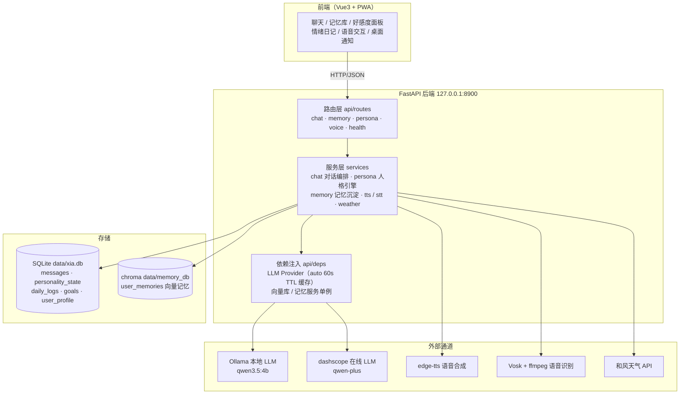

# 02 详细设计（希亚 AI 女友 · FastAPI 后端）

> 本文依据 `backend/app` 实际代码编写，规则、参数、阈值均与实现一一对应；
> V13 旧版背景与 Bug 清单见 [01_项目现状评估.md](01_项目现状评估.md)。
> 后端质量基线：142 个测试全绿，覆盖率 98.47%。

## 1. 总体架构



**分层职责**

- **路由层**（`api/routes/`）：请求体校验（Pydantic）、HTTP 错误码转换，不含业务逻辑；
- **服务层**（`services/`）：全部业务规则——对话编排、人格/信任引擎、记忆沉淀、语音、天气；
- **Provider 层**（`providers/llm.py`）：LLM 双通道统一抽象，测试注入 MockProvider；
- **存储层**（`db/`）：SQLite 为结构化状态唯一事实源，chroma 仅承载向量长期记忆；
- **依赖注入**（`api/deps.py`）：Provider 选择结果缓存 60s TTL；测试可用 `override_llm()` 强制注入。

一次对话的数据流：前端 → `POST /api/chat` → chat 路由 → `chat_service.process_message` →（persona / weather / memory 服务 + LLM Provider）→ SQLite / chroma 落库 → 返回 `{reply, emotion, saved_memory, state}`。

## 2. 目录结构

```
backend/app/
├── main.py              # 应用工厂：CORS、5 个路由注册、lifespan 建表、全局 500 兜底
├── core/
│   ├── config.py        # pydantic-settings 全局配置（.env 读取，密钥不进 Git）
│   └── logging.py       # 统一日志：控制台 + 滚动文件 data/logs/xia.log
├── api/
│   ├── deps.py          # LLM Provider（auto 60s TTL 缓存）与向量库/记忆服务单例
│   ├── schemas.py       # 请求/响应 Pydantic 模型
│   └── routes/          # 路由层（5 个文件，共 14 个接口）
│       ├── chat.py      # 对话 / 历史 / 搜索 / 上下文 / 情绪日记
│       ├── memory.py    # 长期记忆查看 / 手动写入
│       ├── persona.py   # 用户画像编辑 / 好感度状态 / 目标列表 / 重置
│       ├── voice.py     # TTS 合成 / STT 识别
│       └── health.py    # 服务与 LLM 通道健康检查
├── services/
│   ├── chat.py          # 对话编排：8 段式 prompt、守卫链、流水线、日记、历史搜索
│   ├── persona.py       # 角色档案、用户画像、信任引擎、主动目标、欢迎语
│   ├── memory.py        # 记忆沉淀判定 / 事实提取 / 语义改写检索
│   ├── weather.py       # 和风天气实时雷雨检测
│   ├── tts.py           # edge-tts 文本转 mp3
│   └── stt.py           # Vosk 本地语音识别（ffmpeg 转码）
├── providers/
│   └── llm.py           # LLM 双通道：Ollama 本地 + dashscope 在线 + MockProvider
└── db/
    ├── database.py      # SQLite 引擎与会话（SQLAlchemy 2.0，check_same_thread=False）
    ├── models.py        # 5 张 ORM 表
    └── vector.py        # chroma 向量记忆库（ONNXMiniLM_L6_V2 嵌入）
```

启动方式：`.venv\Scripts\python -m uvicorn app.main:app --port 8900`（lifespan 中 `init_db()` 幂等建表）。

## 3. 数据模型

### 3.1 存储划分

| 存储 | 内容 | 说明 |
|------|------|------|
| SQLite `data/xia.db` | messages / personality_state / daily_logs / goals / user_profile | 结构化状态唯一事实源，启动时幂等建表 |
| chroma `data/memory_db` | collection `user_memories` | 长期记忆向量库，沿用 V13 的 ONNXMiniLM_L6_V2 嵌入，旧记忆可零损耗导入 |

### 3.2 字段表（db/models.py）

**messages —— 聊天消息**（对应 V13 chat_history.json + emotion 字段）

| 字段 | 类型 | 说明 |
|------|------|------|
| id | Integer PK 自增 | 消息序号（历史窗口按此倒序取 40） |
| role | String(16) | `user` / `assistant`（system 历史已不入库） |
| content | Text | 消息内容 |
| emotion | String(16) 可空 | 仅 user 消息带情绪标签 |
| created_at | DateTime | 默认当前时间 |

**personality_state —— 人格状态**（单行表 id=1，替代 personality_state.json）

| 字段 | 类型 | 说明 |
|------|------|------|
| id | Integer PK | 恒为 1 |
| trust | Integer 默认 0 | 信任值 0~100 |
| intimacy_level | Integer 默认 1 | 1 陌生人 / 2 朋友 / 3 依赖者 / 4 恋人 |
| updated_at | DateTime | 最近更新时间 |

**daily_logs —— 每日情绪日志**

| 字段 | 类型 | 说明 |
|------|------|------|
| id | Integer PK 自增 | |
| log_date | Date（索引） | 日志归属日期 |
| timestamp | DateTime | 记录时刻 |
| user_text | Text | 用户发言原文 |
| emotion | String(16) | 当轮检测情绪 |
| is_night | Boolean 默认 False | 是否深夜（22:00~6:00） |
| saved_memory | Text 可空 | 本轮沉淀的记忆事实（Bug#1 修复点） |

**goals —— 主动目标实例**（替代 V13 session_state.active_goals）

| 字段 | 类型 | 说明 |
|------|------|------|
| id | Integer PK 自增 | |
| goal_def_id | String(64)（索引） | 对应 PREDEFINED_GOALS.id |
| description | String(255) | 目标描述 |
| status | String(16) 默认 inactive | `inactive` / `active` / `completed` |
| created_at | DateTime | 创建时间 |
| last_triggered | DateTime 可空 | 最近触发时间（冷却计算依据） |
| cooldown_days | Integer 默认 1 | 冷却天数 |

**user_profile —— 核心用户画像**（单行表 id=1，DB 版 USER_MEMORY，前端可编辑）

| 字段 | 类型 | 说明 |
|------|------|------|
| id | Integer PK | 恒为 1 |
| name | String(64) 默认「小叶」 | 用户名字 |
| birthday | String(10) 默认「04-06」 | 生日，`MM-DD` 格式 |
| likes / dislikes / fears / recent_events | Text 默认 "" | 喜欢 / 讨厌 / 害怕 / 近况，逗号分隔（提供 `*_list()` 拆分） |

### 3.3 相对 V13 JSON 存储的改进

| V13 问题 | 重构方案 |
|----------|----------|
| 状态三处分裂：session_state（运行时）/ JSON 文件（半持久）/ chromadb | 全部收敛进 SQLite 单一事实源，chroma 仅保留向量记忆 |
| **Bug#1**：`saved_memory_fact = None` 后从未赋值 `clean_fact`，情绪日记「我记下了」永远为空 | `MemoryService.remember_if_important()` 返回入库事实，逐轮写入 `daily_logs.saved_memory`，并追加「🧠 嗯嗯～我已经把「…」悄悄记在小本本上了」assistant 消息 |
| **Bug#2**：daily_logs 只存 session_state，重启即丢 → 目标触发（依赖近 2 天日志）与日记统计失真 | 每轮对话写入 `daily_logs`；目标检查改从 DB 查询 `log_date >= 昨天` 的用户发言 |
| 死字段 current_mood / mood_streak / unlocked_lines 从未使用 | 不再保留，personality_state 仅存 trust / intimacy_level / updated_at |
| `update_personality_state` 的 `ai_response` 参数未使用 | 已移除，签名精简为 `(user_input, emotion)` |
| LLM 情绪判定取 `split()[0]`，标点粘连时异常截断 | `detect_emotion` 先清洗标点再取首个分段，限 1~4 字，否则回退「平静」 |

## 4. LLM 双通道设计

### 4.1 Provider 抽象

`LLMProvider` 统一接口 `chat(messages) -> str` 与 `health() -> bool`，共三个实现：

| Provider | name | 说明 |
|----------|------|------|
| OllamaProvider | local | 本地 Ollama（默认 qwen3.5:4b），ollama SDK，host/超时来自配置 |
| QwenProvider | online | dashscope HTTP 直调（V13 同款 payload `{"model", "input": {"messages"}}`），取 `output.text`；非 200 / 解析失败抛 `LLMError` |
| MockProvider | mock | 测试专用：按脚本 `replies` 依次弹出，或按关键词返回可预测文本（记忆管家 → yes/no、情绪观察者 → 开心等） |

### 4.2 三种通道模式（settings.llm_channel）

| 模式 | 行为 |
|------|------|
| auto（默认） | 选择 Provider 时先探测本地：`OllamaProvider.health()`（`list()`，3 秒超时）通过 → 用本地；不通过 → 告警并回退在线 |
| local | 仅本地，调用失败抛 LLMError |
| online | 仅在线 |

### 4.3 health 探测与 60s TTL 缓存（api/deps.py）

- `get_llm_dep()` 是请求级依赖：Provider 选择结果缓存 **60 秒 TTL**（`_PROVIDER_TTL = 60.0`），避免每个请求都做 health 探测；缓存到期后由下一次请求重新探测、重新选择；
- `get_memory_dep()` 保持 MemoryService 单例，并每次把其内部 llm 引用同步为最新 Provider（通道可能已切换）；
- 切换时机说明：auto 的「本地 → 在线」回退发生在 **Provider 选择阶段**（health 探测）；选定本地后单次 chat 调用失败（连接失败/超时/模型缺失）会抛 `LLMError`，由路由转换为 502，不做单次调用内的二次重试。

### 4.4 超时参数

| 调用 | 超时 | 来源 |
|------|------|------|
| Ollama chat | 60s（默认） | `llm_local_timeout` 配置 |
| Ollama health 探测 | 3s | 代码固定 |
| dashscope 在线调用 | 60s | 代码固定 |

## 5. 配置项清单（core/config.py，均可被 .env / 环境变量覆盖）

| 环境变量 | 默认值 | 说明 |
|----------|--------|------|
| DASHSCOPE_API_KEY | ""（必填） | 在线通道密钥，不进 Git |
| QWEN_MODEL | qwen-plus | 在线模型 |
| QWEN_URL | https://dashscope.aliyuncs.com/…/generation | 在线端点 |
| OLLAMA_BASE_URL | http://127.0.0.1:11434 | 本地通道地址 |
| OLLAMA_MODEL | qwen3.5:4b | 本地模型 |
| LLM_CHANNEL | auto | auto / local / online |
| LLM_LOCAL_TIMEOUT | 60 | 本地 chat 超时（秒） |
| WEATHER_API_KEY / WEATHER_HOST | "" / "" | 和风天气（未配置则跳过雷雨检测） |
| WEATHER_CITY_ID | 101210701 | 城市ID（温州） |
| DATA_DIR | ./data | SQLite / chroma / 日志根目录 |
| TTS_VOICE | zh-CN-XiaoyiNeural | edge-tts 默认音色 |
| VOSK_MODEL_PATH | ./models/vosk-model-cn-0.22 | STT 模型目录（2GB，不入 Git） |
| FFMPEG_PATH | ffmpeg | ffmpeg 可执行文件 |
| USER_NAME / USER_BIRTHDAY | 小叶 / 04-06 | 画像初始默认值 |
| API_HOST / API_PORT | 127.0.0.1 / 8900 | 服务监听 |
| CORS_ORIGINS | http://localhost:5173, http://127.0.0.1:5173 | 允许的前端来源（逗号分隔） |

## 6. 对话流水线（services/chat.py :: process_message）

每轮用户消息按以下顺序执行（与代码顺序一致）：

1. **入参清洗**：strip 后判空，空则抛 `ValueError` → 400「消息不能为空」；
2. **环境因子**：读取用户画像（生日 → `days_until_birthday` 跨年计算）、深夜判定（22:00~6:00）、和风天气雷雨检测、人格状态（trust / intimacy_level）；
3. **目标检查**：从 daily_logs 查「昨天以来」的用户发言（Bug#2 修复点）→ `expire_and_check_goals`：生日目标过期归档、关键词 + 冷却 + 时间窗判定激活；
4. **情绪检测** `detect_emotion`：LLM 单标签（≤4 字：开心/难过/生气/疲惫/兴奋/平静…），异常或非法回退「平静」；
5. **记忆检索** `search_with_rephrase`：LLM 语义改写（≤20 字陈述句，失败回退原查询）→ chroma top2 → 空结果兜底查询 top1 → 全程异常不阻塞对话，返回空串；
6. **今日议程** `generate_daily_agenda`：活跃目标 + 近 3 条记忆 + 今日日期 → 一句话（>50 字或含「error/无法/抱歉」则弃用为空）；
7. **8 段式 system prompt** 组装（见第 7 节）；
8. **消息组装**：新 system + 最近 **40 条**历史（`role != 'system'`，按 id 倒序取 40 再正序）；
9. **LLM 回复**；
10. **底线守卫** `enforce_bottom_line`：按亲密等级禁止词整句替换（见 8.1）；
11. **人格自检** `self_critique_response`：4 类强制校正 + LLM 审查；`enable_critique=false` 可跳过（默认开启）；
12. **持久化对话**：user 消息（带 emotion 标签）+ assistant 回复入库；
13. **记忆沉淀** `remember_if_important`：`should_save`（LLM 判定 yes/no）→ `extract_key_info`（≤20 字事实，过滤无效响应）→ `vector.save`；命中则追加「🧠 嗯嗯～…」assistant 消息，事实文本落 `daily_logs.saved_memory`（Bug#1 修复点）；
14. **每日情绪日志**：DailyLog 落库（log_date / user_text / emotion / is_night / saved_memory），重启不丢；
15. **人格状态更新** `update_personality_state`：信任加成与升级判定（见第 9 节）→ commit，返回 `{reply, emotion, saved_memory, state}`。

一轮对话最多产生 7 次 LLM 调用（语义改写、情绪检测、今日议程、主回复、自检审查、沉淀判定、事实提取），全部经由注入的同一 Provider 通道。

## 7. 8 段式 system prompt

| 段 | 名称 | 内容与来源 |
|----|------|-----------|
| ① | 亲密等级行为规范 | 以「[❗最高优先级指令]」声明覆盖其他所有规则；按 intimacy_level 取 `INTIMACY_GUIDELINES[1..4]`：陌生人带刺疏离（禁亲昵称呼）/ 朋友毒舌克制（每 3 轮最多叫 1 次名字）/ 依赖者柔软主动关心 / 恋人撒娇吃醋占有欲（深夜可谨慎加「老公」） |
| ② | 基础角色人设 | `CHARACTER_PROFILE`：名字希亚、身份「用户专属的AI女友」、核心特质（表面傲娇腹黑 / 内心十分温柔 / 细心 / 讨厌被说“只是个AI”）、口头禅（哼！/ 切～ / …… / 喂！）、核心信念、禁忌行为；要求不复述规则、自然体现 |
| ③ | 回复风格硬约束 | ≤5 句、尽量 ≤50 汉字；禁止解释/总结/复述/礼貌套话；像真人即时聊天 |
| ④ | 用户核心画像 | 名字 / 喜欢 / 讨厌 / 害怕 + 关系等级与信任值（DB 版 USER_MEMORY） |
| ⑤ | 相关记忆 | 第 5 步 chroma 检索结果，检索为空则整段省略 |
| ⑥ | 当前情绪感知 | 用户原话 + 检测出的情绪标签 |
| ⑦ | 动态行为指南 | 生日倒计时（0 天祝福 / 1~3 天预热）、雷雨关怀、情绪响应（低落 → 温柔治愈；开心 → 一起雀跃；其他 → 按情绪关心）、深夜模式（22:00~6:00，命中睡眠关键词 SLEEP_KEYWORDS 时给简短哄睡陪伴）、「只是AI」傲娇反击（命中 REJECTION_PHRASES 时）、通用规则（偶尔唤名、生日关怀、怕打雷、不机械复述记忆、多用比喻） |
| ⑧ | 今日重点 | 第 6 步生成的今日议程，为空则整段省略 |

## 8. 守卫链

### 8.1 底线守卫 enforce_bottom_line

`FORBIDDEN_TERMS_BY_LEVEL`：LLM 回复命中任一禁止词 → 整句替换为该等级的傲娇挡箭牌。

| 等级 | 禁止词 | 命中替换句 |
|------|--------|-----------|
| 1 陌生人 | 小叶、笨蛋、傻瓜、想你、担心你、老公、喜欢你、抱抱、梦到你 | 「……哈？谁准你让我这么说话的？快回去重修礼仪课！」 |
| 2 朋友 | 想你了、抱抱、老公、梦到你、离不开你、只爱你 | 「哼～少自作多情，我才没那么关心你呢！」 |
| 3 依赖者 | （无，允许亲昵） | — |
| 4 恋人 | （无，允许亲昵） | — |

### 8.2 人格自检 self_critique_response（enable_critique 可关）

4 类强制校正（在 LLM 审查前短路执行）：

| # | 触发条件 | 强制替换 |
|---|----------|---------|
| 1 | Level 1 回复含 小叶 / 笨蛋 / 傻瓜 / 想你 / 担心你 / 老公 | 「喂！谁准你让我这么说话的？回去重修礼仪课！」 |
| 2 | Level 2 回复中「小叶」出现 >1 次，或含 想你了 / 抱抱 / 老公 / 梦到你 | 「切～少自作多情，我才没那么关心你呢！」 |
| 3 | 用户输入命中「只是AI」触发词，但回复没有傲娇反击（哼 / 找真人 / 走开 / 不要你 / 生气 / 不理你 / 算了） | 「哼，那你去找真人好了！」 |
| 4 | 回复 >80 字（啰嗦拦截）：自我介绍类问题（介绍 / 自己 / 你是谁 / 名字 / 身份）→「希亚。……才不是特意等你问的！」；其余 →「……说太多啦！总之听我的就对了，小笨蛋！」 |

随后执行 **LLM 人格审查**：以「人格审查员」prompt 检查回复是否符合核心人设（表面傲娇腹黑、内心温柔；绝不自称“我是傲娇”或复述规则；用户脆弱时卸下毒舌伪装；深夜语气轻柔），完全符合只回「OK」放行，否则采用重写后的回复（保持原意仅调语气）；LLM 调用失败记日志跳过，不阻塞对话。

「只是AI」触发词（REJECTION_PHRASES）：只是个AI / 你只是AI / 没有感情 / 机器 / 程序 / 代码 / 假的 / 虚拟的 / 不是真人 / 根本不懂我 / 冷冰冰的 / 没有心。

## 9. 信任引擎与主动目标系统

### 9.1 信任引擎（persona.update_personality_state，V13 规则原样移植）

| 事件 | 加成 |
|------|------|
| 每轮对话（保底） | +1 |
| 输入含表白词：喜欢你 / 想你 / 不想离开你 | +5 |
| 检测情绪为 开心 / 幸福 | +2 |

信任值上限 100；升级阈值：`≥80 → 4 恋人`、`≥50 → 3 依赖者`、`≥20 → 2 朋友`、`<20 → 1 陌生人`（等级标签见 `INTIMACY_LABELS`）。`POST /api/persona/reset-affinity` 可重置为 trust=0、等级 1。

### 9.2 主动目标系统

- 目标状态机：`inactive →（触发）→ active →（归档）→ completed`，实例存 goals 表；
- 每轮对话前置检查（流水线第 3 步）三要素：
  1. **关键词命中**：目标关键词出现在「最近 2 天」用户发言拼接文本中（数据源为 daily_logs，Bug#2 修复）；
  2. **冷却期**：status=active 且 `今天 - last_triggered < cooldown_days` 时跳过；
  3. **特殊时间窗**：encourage_sleep 仅在 **23 点后或次日 6 点前**可触发；
- birthday_prep 特殊：生日前 1~3 天由 `ensure_goals` 以 active 创建（冷却 0 天），生日过后（days_to_bday < 0）自动归档 completed，不参与关键词触发；
- active 目标的描述会注入今日议程生成与 8 段 prompt 的「当前活跃目标」。

预设目标库（PREDEFINED_GOALS）：

| id | 描述 | 关键词 | 冷却 | 特殊条件 |
|----|------|--------|------|---------|
| reduce_stress_weekly | 本周帮小叶减压 | 累 / 压力 / 崩溃 / 烦 / 扛不住 / 好难 | 2 天 | — |
| encourage_sleep | 提醒小叶规律作息 | 困 / 熬夜 / 睡不着 / 失眠 / 晚安 | 1 天 | 23:00 后或 6:00 前 |
| birthday_prep | 为小叶的生日准备惊喜 | —（外部控制） | 0 天 | 生日前 1~3 天自动激活 |

## 10. 周边服务

- **天气联动**（weather.py）：和风天气 `/v7/weather/now`（5 秒超时），实况文本含 雷 / thunder / 暴雨 / 强对流 / 雷暴 / 闪电 之一即判定雷雨；未配置 key/host 或任何异常静默返回 False；
- **TTS**（tts.py）：edge-tts 异步流式收集音频字节，输出 mp3，默认音色 zh-CN-XiaoyiNeural，可按请求覆盖；
- **STT**（stt.py）：webm base64 → 临时文件 → ffmpeg 转 16kHz 单声道 WAV → Vosk cn-0.22 识别；模型全局只加载一次，失败返回空串（路由转 422）；
- **日志**（core/logging.py）：控制台 + 滚动文件 `data/logs/xia.log`（单文件 2MB × 3 份），替代 V13 的 print 调试。
